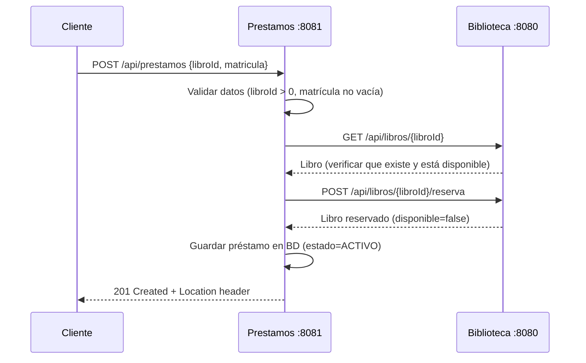

# 📚 Proyecto Servicios — Sistema de Biblioteca con Arquitectura SOA

Sistema de gestión de biblioteca construido con una **Arquitectura Orientada a Servicios (SOA)** usando **Spring Boot 4.1.1** y **Java 21**. Permite consultar libros, realizar reservas y gestionar préstamos a través de servicios REST y SOAP, con un frontend web como consumidor.

---

## 🏗️ Arquitectura

```
                         ┌──────────────────────┐
                         │  consumidor-biblioteca│
                         │  (HTML/JS — :5500)    │
                         └──┬────────────┬───────┘
                            │            │
          ┌─────────────────┘            └──────────────────┐
          │ GET /api/integracion/                            │ POST /api/prestamos
          │     libros/{id}                                  │ GET  /api/prestamos
          ▼                                                  ▼
  ┌────────────────┐                              ┌────────────────┐
  │   integrador   │                              │   prestamos    │
  │ (SOAP→REST     │                              │  (REST — :8081)│
  │  Bridge — :8082)│                              └───────┬────────┘
  └───────┬────────┘                                       │
          │ SOAP                                           │ REST
          │ POST /ws                                       │ GET  /api/libros/{id}
          │                                                │ POST /api/libros/{id}/reserva
          ▼                                                ▼
  ┌────────────────────────────────────────────────────────────────┐
  │                        biblioteca                              │
  │                   (REST + SOAP — :8080)                        │
  └────────────────────────────┬───────────────────────────────────┘
                               │
                               ▼
                    ┌──────────────────────┐
                    │     PostgreSQL       │
                    │  biblioteca_soa      │
                    │  prestamos_soa       │
                    └──────────────────────┘
```

> [!NOTE]
> El servicio **integrador** actúa como un puente SOAP→REST: consume el endpoint SOAP de **biblioteca** y lo re-expone como REST. El servicio **prestamos** se comunica directamente con **biblioteca** vía REST para verificar disponibilidad y reservar libros.

---

## 📦 Módulos

### 1. `biblioteca` — Servicio de Libros (Core)
Microservicio central y dueño de los datos del catálogo de libros. Expone APIs **REST** y **SOAP**.

- **Puerto:** `8080`
- **Base de datos:** PostgreSQL (`biblioteca_soa`)
- **Tecnologías:** Spring Boot, Spring WS (SOAP), Spring Data JPA, wsdl4j

#### Endpoints REST

| Método | Ruta                        | Descripción                                |
|--------|-----------------------------|--------------------------------------------|
| GET    | `/api/libros`               | Listar todos los libros (ordenados por id) |
| GET    | `/api/libros/{id}`          | Obtener libro por ID                       |
| POST   | `/api/libros/{id}/reserva`  | Reservar un libro (marca como no disponible) |
| POST   | `/api/xml/validar`          | Validar XML contra esquema `libro.xsd`     |

> [!IMPORTANT]
> La reserva es **atómica**: usa una query UPDATE directa que sólo reserva si el libro está disponible. Retorna `409 Conflict` si ya está reservado.

#### Endpoint SOAP

| Propiedad   | Valor                                       |
|-------------|---------------------------------------------|
| **URL**     | `http://localhost:8080/ws`                   |
| **WSDL**    | `http://localhost:8080/ws/biblioteca.wsdl`   |
| **Namespace** | `http://ejemplo.com/biblioteca/soap`       |
| **Operación** | `consultarLibroRequest` → `consultarLibroResponse` |

#### Modelo de datos — `Libro`

| Columna      | Tipo         | Descripción                 |
|--------------|--------------|-----------------------------|
| `id`         | int (identity) | Identificador único       |
| `titulo`     | varchar(200) | Título del libro            |
| `autor`      | varchar(150) | Autor del libro             |
| `disponible` | boolean      | Disponibilidad para préstamo |

---

### 2. `prestamos` — Servicio de Préstamos
Microservicio que orquesta el flujo de préstamos: verifica disponibilidad, reserva el libro en **biblioteca** y registra el préstamo.

- **Puerto:** `8081`
- **Base de datos:** PostgreSQL (`prestamos_soa`)
- **Tecnologías:** Spring Boot, Spring Data JPA

#### Endpoints REST

| Método | Ruta                 | Descripción                  |
|--------|----------------------|------------------------------|
| GET    | `/api/prestamos`     | Listar todos los préstamos   |
| GET    | `/api/prestamos/{id}`| Obtener préstamo por ID      |
| POST   | `/api/prestamos`     | Registrar un nuevo préstamo  |

#### Body para crear préstamo
```json
{
  "libroId": 1,
  "matricula": "A12345"
}
```

#### Flujo de registro de préstamo


#### Modelo de datos — `Prestamo`

| Columna         | Tipo         | Descripción                |
|-----------------|--------------|----------------------------|
| `id`            | int (identity) | Identificador único      |
| `libro_id`      | int          | ID del libro prestado      |
| `titulo_libro`  | varchar(200) | Título del libro           |
| `matricula`     | varchar(50)  | Matrícula del usuario      |
| `fecha_prestamo`| date         | Fecha del préstamo         |
| `estado`        | varchar(20)  | Estado del préstamo (ACTIVO) |

---

### 3. `integrador` — Puente SOAP → REST
Servicio adaptador que consume el endpoint SOAP de **biblioteca** y lo expone como un endpoint REST. Actúa como traductor de protocolos.

- **Puerto:** `8082`
- **Sin base de datos**
- **Tecnologías:** Spring Boot

#### Endpoint REST

| Método | Ruta                             | Descripción                               |
|--------|----------------------------------|-------------------------------------------|
| GET    | `/api/integracion/libros/{id}`   | Consultar libro (vía SOAP a biblioteca)   |

#### Funcionamiento interno
- Construye un envelope SOAP 1.1 con `consultarLibroRequest`
- Envía POST a `http://localhost:8080/ws` usando `java.net.http.HttpClient`
- Parsea la respuesta XML manualmente (DOM, namespace-aware)
- Traduce SOAP Faults: `Client` → HTTP 422, otros → HTTP 502
- Timeouts: conexión 3s, request 8s

---

### 4. `consumidor-biblioteca` — Frontend Web
Aplicación web estática que consume los servicios REST del sistema.

- **Puerto:** `5500`
- **Tecnologías:** HTML, JavaScript (vanilla), CSS inline

#### Versiones disponibles

| Archivo | Descripción | Servicios consumidos |
|---------|-------------|----------------------|
| `index.html` + `app.js` | **Versión completa:** consulta de libros, solicitud de préstamos y listado de préstamos | integrador (:8082) + prestamos (:8081) |
| `index_1.html` + `app_1.js` | **Versión simple:** solo consulta de libros | biblioteca (:8080) directamente |

#### Funcionalidades (versión completa)
- 🔍 **Consultar libro:** busca por ID a través del integrador (SOAP bridge)
- 📋 **Solicitar préstamo:** envía libro ID + matrícula al servicio de préstamos
- 📊 **Ver préstamos:** tabla con todos los préstamos registrados

---

## ⚙️ Requisitos Previos

- **Java 21** (JDK)
- **PostgreSQL** (en ejecución, puerto 5432)
- **Python 3** (para servir el frontend)
- **Maven** (incluido como wrapper `mvnw`)

---

## 🗄️ Configuración de Bases de Datos

Crear las bases de datos y usuarios en PostgreSQL:

```sql
-- Base de datos de biblioteca
CREATE DATABASE biblioteca_soa;
CREATE USER biblioteca_app WITH PASSWORD '<tu_contraseña>';
GRANT ALL PRIVILEGES ON DATABASE biblioteca_soa TO biblioteca_app;

-- Base de datos de préstamos
CREATE DATABASE prestamos_soa;
CREATE USER prestamos_app WITH PASSWORD '<tu_contraseña>';
GRANT ALL PRIVILEGES ON DATABASE prestamos_soa TO prestamos_app;
```

> [!WARNING]
> Las contraseñas se configuran mediante **variables de entorno** (`BIBLIOTECA_DB_PASSWORD` y `PRESTAMOS_DB_PASSWORD`). Las tablas deben existir previamente ya que JPA usa `ddl-auto=validate`.

### Esquema de tablas

```sql
-- En biblioteca_soa
CREATE TABLE public.libros (
    id     INT GENERATED ALWAYS AS IDENTITY PRIMARY KEY,
    titulo VARCHAR(200) NOT NULL,
    autor  VARCHAR(150) NOT NULL,
    disponible BOOLEAN NOT NULL DEFAULT TRUE
);

-- En prestamos_soa
CREATE TABLE public.prestamos (
    id             INT GENERATED ALWAYS AS IDENTITY PRIMARY KEY,
    libro_id       INT NOT NULL,
    titulo_libro   VARCHAR(200) NOT NULL,
    matricula      VARCHAR(50) NOT NULL,
    fecha_prestamo DATE NOT NULL,
    estado         VARCHAR(20) NOT NULL
);
```

---

## 🚀 Ejecución

Configurar las variables de entorno y luego iniciar los servicios **en orden** (cada uno en una terminal separada):

### 0. Variables de entorno
```powershell
$env:BIBLIOTECA_DB_PASSWORD = "tu_contraseña_biblioteca"
$env:PRESTAMOS_DB_PASSWORD = "tu_contraseña_prestamos"
```

### 1. Servicio Biblioteca
```bash
cd biblioteca
.\mvnw.cmd spring-boot:run
```

### 2. Servicio Préstamos
```bash
cd prestamos
.\mvnw.cmd spring-boot:run
```

### 3. Servicio Integrador
```bash
cd integrador
.\mvnw.cmd spring-boot:run
```

### 4. Frontend
```bash
cd consumidor-biblioteca
py -m http.server 5500 --bind 127.0.0.1
```

Abrir el navegador en: **http://127.0.0.1:5500**

---

## 🔗 Resumen de Puertos y URLs

| Servicio               | Puerto | Protocolo    | URL principal                              |
|------------------------|--------|--------------|--------------------------------------------|
| Biblioteca (REST)      | 8080   | REST         | `http://localhost:8080/api/libros`          |
| Biblioteca (SOAP)      | 8080   | SOAP         | `http://localhost:8080/ws`                  |
| Biblioteca (WSDL)      | 8080   | WSDL         | `http://localhost:8080/ws/biblioteca.wsdl`  |
| Préstamos              | 8081   | REST         | `http://localhost:8081/api/prestamos`       |
| Integrador             | 8082   | REST (→SOAP) | `http://localhost:8082/api/integracion/libros/{id}` |
| Frontend               | 5500   | HTTP         | `http://127.0.0.1:5500`                    |

---

## 🛠️ Tecnologías

| Tecnología                  | Uso                                      |
|-----------------------------|------------------------------------------|
| **Java 21**                 | Lenguaje de programación                 |
| **Spring Boot 4.1.1**       | Framework de aplicación                  |
| **Spring Web / WebMVC**     | APIs REST                                |
| **Spring Web Services**     | Endpoint SOAP + WSDL                     |
| **Spring Data JPA**         | Persistencia de datos                    |
| **PostgreSQL**              | Base de datos relacional                 |
| **wsdl4j**                  | Generación de WSDL                       |
| **Maven (Wrapper)**         | Gestión de dependencias y build          |
| **HTML / JavaScript**       | Frontend (vanilla, sin frameworks)       |
